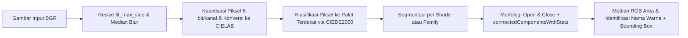
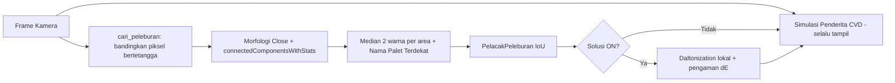

# Sistem Deteksi Warna & Koreksi Buta Warna (CVD) berbasis OpenCV

Prototipe sistem deteksi objek berwarna bernuansa, simulasi buta warna (_Color Vision Deficiency_), dan koreksi warna (_daltonization_) berbasis ruang warna CIELAB dan jarak persepsi CIEDE2000. Mendukung pemrosesan gambar statis, evaluasi kuantitatif $\Delta E$, deteksi multi-warna _real-time_ lewat webcam, serta kamera buta warna yang menandai dan mengoreksi area warna yang melebur.


---

## Latar Belakang & Tujuan

Penderita buta warna (_Color Vision Deficiency_ / CVD), yaitu protanopia, deuteranopia, maupun tritanopia, tidak kehilangan warna sepenuhnya. Yang terjadi adalah dua warna yang tampak berbeda jelas bagi penglihatan normal (misalnya merah dan hijau) terlihat hampir sama atau "melebur". Proyek ini dibuat sebagai prototipe tugas **Week 8, Progress Submission (Computer Vision)** untuk:

1. menamai warna objek secara bernuansa memakai metrik yang mendekati persepsi manusia (CIEDE2000),
2. mensimulasikan penglihatan penderita CVD secara komputasional,
3. mendeteksi area perbatasan warna yang melebur, lalu mengoreksinya secara lokal (_daltonization_) dengan pengaman, baik pada gambar statis maupun kamera _real-time_.

---

## Fitur Utama

1. **Deteksi objek berwarna** dengan _bounding box_ dan label nama warna bernuansa (mis. _Merah Marun, Merah Tua, Merah, Merah Muda (Pink), Biru Navy, Biru Tua, Biru Muda_) dari palet **34 warna** dalam **10 keluarga warna** (Merah, Pink, Oranye, Coklat, Kuning, Hijau, Tosca, Biru, Ungu, Netral).
2. **Ekstraksi nilai warna lengkap**: RGB, HEX, HSV, dan CIELAB untuk setiap objek, dilengkapi penanda `ambigu` dan kolom `Mirip dengan` bila selisih $\Delta E$ kandidat pertama dan kedua $< 2,0$.
3. **Inspeksi titik (`inspect_point`)**: masukkan koordinat `(x, y)` dan radius piksel untuk membaca RGB, HEX, HSV, Lab, nama warna, dan 3 kandidat warna palet terdekat.
4. **Warna dominan (`dominant_colors`)** menggunakan _k-means_ beserta persentase cakupan areanya.
5. **Simulasi CVD & _Daltonization_** untuk tampilan penderita _protanopia_, _deuteranopia_, dan _tritanopia_, serta penggeseran informasi warna yang hilang ke kanal yang masih dapat dibedakan.
6. **Evaluasi kuantitatif**: $\Delta E$ (CIEDE2000) antar pasangan warna sebelum/sesudah koreksi, evaluasi pada warna dominan gambar, uji ketahanan penamaan warna pada data sintetis, dan _benchmark_ kecepatan.
7. **Ekspor _batch_ (`process_folder`)**: seluruh gambar di folder diproses menjadi gambar beranotasi, gambar hasil _daltonization_, tabel `deteksi_warna.csv`, dan arsip `hasil_cvd.zip`.
8. **Deteksi multi-warna _real-time_ via webcam** (Sel 20 sampai 24) dengan pelacak IoU (`PelacakWarna`) agar kotak tidak berkedip, kalibrasi _white balance_ (`kalibrasi_putih`), dan koreksi eksposur gamma (`koreksi_eksposur`).
9. **Kamera Buta Warna** (Sel 25 sampai 29): layar menampilkan tampilan penderita CVD, dan _toggle_ **Solusi** menandai area warna bersebelahan yang melebur (kotak, dua nama warna, nilai $\Delta E$) lalu menerapkan _daltonization_ lokal dengan pengaman. Tersedia **Mode Area** (seluruh layar) dan **Mode Fokus Tengah** (membaca dan mengoreksi satu kotak bidik).

---

## Tech Stack & Prasyarat

- **Bahasa & Lingkungan:** Python 3.10 atau lebih baru, dijalankan pada Jupyter Notebook lokal di VS Code.
- **Pustaka Python:**
    - `opencv-python` (versi tercatat pada output: `5.0.0`)
    - `numpy` (versi tercatat pada output: `2.4.4`)
    - `pandas`
    - `matplotlib`
- **Perangkat Keras & Kamera:** Webcam internal atau _virtual camera_ **Iriun Webcam** di Windows. Pembukaan kamera mencoba _backend_ `cv2.CAP_MSMF`, lalu `cv2.CAP_ANY`, lalu `cv2.CAP_DSHOW`.

---

## Instalasi & Cara Menjalankan

### 1. Persiapan Lingkungan

```bash
git clone https://github.com/lafrellephm/color-detection-cvd-correction.git
cd color-detection-cvd-correction

python -m venv .venv
# Aktivasi venv di Windows:
.venv\Scripts\activate
# Aktivasi venv di Linux/macOS:
source .venv/bin/activate

pip install opencv-python numpy pandas matplotlib ipykernel
```

### 2. Membuka dan Menjalankan Notebook

1. Buka folder proyek di **VS Code** dan buka file `Progress_Deteksi_Warna_ColorBlind.ipynb`.
2. Pilih _kernel_ Python dari `.venv` yang telah dibuat.
3. **Urutan Eksekusi Sel Dasar & Evaluasi Gambar Statis:**
    - Jalankan **Sel 1 sampai Sel 19** secara berurutan untuk memuat fungsi inti, memverifikasi implementasi CIEDE2000, membuat gambar demo, menjalankan deteksi warna, simulasi CVD, evaluasi $\Delta E$, dan ekspor _batch_.
4. **Mengganti Sumber Gambar ke Dataset Sendiri:**
    - Pada **Sel 10**, ubah variabel `CARA_INPUT`:
        ```python
        CARA_INPUT = "demo"    # Default: membuat gambar sintetis di dataset/demo_nuansa.png
        # atau
        CARA_INPUT = "folder"  # Membaca semua gambar di folder dataset/
        ```
5. **Urutan Menjalankan Deteksi Multi-Warna via Webcam (Sel 20 sampai 24):**
    - Pastikan **Sel 1 sampai 8** sudah dijalankan.
    - Jalankan **Sel 20** (fungsi pemrosesan frame dan pelacak) $\rightarrow$ **Sel 21** (koneksi kamera Iriun, pemindaian kamera, `CAMERA_INDEX`) $\rightarrow$ **Sel 22** (tes satu foto dan koreksi eksposur) $\rightarrow$ **Sel 23** (_opsional_, kalibrasi kertas putih) $\rightarrow$ **Sel 24** (deteksi multi-warna _live_).
6. **Urutan Menjalankan Kamera Buta Warna / CVD (Sel 25 sampai 29):**
    - Pastikan **Sel 1 sampai 8** dan **Sel 20 sampai 21** sudah dijalankan.
    - Jalankan **Sel 25** (konstanta, matriks simulasi Machado/Brettel, uji simulasi) $\rightarrow$ **Sel 26** (deteksi peleburan warna, _lookup table_, pelacak, koreksi lokal, Mode Fokus Tengah) $\rightarrow$ **Sel 27** (antarmuka OpenCV dan _overlay_) $\rightarrow$ **Sel 28** (uji tanpa kamera pada gambar sintetis) $\rightarrow$ **Sel 29** (kamera CVD _live_).

### Kontrol Navigasi Kamera Buta Warna (Sel 29)

Kontrol dapat dilakukan dengan mengklik tombol di bagian atas jendela video atau menekan tombol _keyboard_ saat jendela OpenCV aktif:

- `1` / `2` / `3` : Ganti mode simulasi ke **Protanopia** / **Deuteranopia** / **Tritanopia**.
- `S` atau `Spasi` : _Toggle_ **Solusi** (`ON` / `OFF`) untuk mendeteksi area melebur dan mengaktifkan koreksi lokal.
- `F` atau `M` : Ganti mode antara **Area** (seluruh layar) dan **Fokus Tengah**.
- `-` / `+` : Perkecil / perbesar kotak bidik pada Mode Fokus Tengah (rentang 30 sampai 220 px, langkah 15 px).
- `N` : _Toggle_ tampilan **Normal** (asli) vs tampilan simulasi CVD.
- `Q` atau `ESC` : Menghentikan kamera dan menutup jendela.

Pemanggilan bawaan Sel 29 adalah `jalankan_kamera_cvd(mode_fokus="tengah", mode_awal="deuteranopia")`. Ubah `mode_fokus="area"` untuk langsung memakai deteksi multi-area.

### Kontrol Webcam Multi-Warna (Sel 24)

- `M` : Ganti mode antara deteksi multi-objek dan baca satu warna di kotak tengah.
- `K` : Kalibrasi putih (arahkan kertas putih ke kotak tengah).
- `R` : Reset kalibrasi putih.
- `Q` atau `ESC` : Berhenti.

---

## Pendekatan Teknis

### Diagram Alur Pipeline Deteksi Warna (`detect_colors`)



### Diagram Alur Kamera Buta Warna (Mode Area)



### Algoritma & Metode Kunci

- **Jarak Warna CIEDE2000 di Ruang CIELAB (`ciede2000`):** Jarak Euclidean pada ruang RGB tidak mencerminkan persepsi visual manusia. Sistem mengonversi sRGB ke CIELAB dan menghitung jarak dengan formula CIEDE2000 yang mengompensasi _lightness_ ($S_L$), _chroma_ ($S_C$), _hue_ ($S_H$), serta interaksi biru-ungu ($R_T$). Implementasi diverifikasi terhadap 5 data uji referensi Sharma, Wu, & Dalal (2005) dengan galat $< 10^{-3}$ (fungsi `uji_ciede2000`).
- **Kuantisasi Piksel untuk Efisiensi (`classify_pixels`):** Piksel dikuantisasi menjadi 6-bit per kanal (`(rgb // 4) * 4 + 2`), hanya warna unik yang dihitung jaraknya ke palet dengan `np.unique`, lalu hasilnya dipetakan kembali ke ukuran gambar penuh.
- **Penamaan dari Median Area:** Nama dan RGB sebuah objek diambil dari **median** piksel di dalam areanya (tahan _noise_ dan _highlight_), bukan dari satu piksel. Hasil ditandai `ambigu` bila kandidat kedua hampir sama dekatnya.
- **Simulasi CVD di Ruang RGB Linear:** sRGB didekode ke RGB linear sebelum dikalikan matriks proyeksi, lalu dikodekan kembali. _Protanopia_ dan _deuteranopia_ memakai matriks **Machado et al. (2009)** dengan _severity_ 1,0. Untuk **tritanopia**:
    - Sel 14 sampai 17 (evaluasi gambar statis) memakai matriks Machado.
    - Sel 25 sampai 29 (kamera CVD) memakai model dua bidang proyeksi **Brettel, Viénot, & Mollon (1997)**, dengan konstanta yang diturunkan dari _DaltonLens-Python_ (lisensi MIT).
- **_Daltonization_ (Pergeseran Error):** Informasi warna yang hilang (`warna asli - simulasi`) dikalikan matriks `ERR_SHIFT` lalu ditambahkan ke warna asli. Protan dan deutan memakai `[[0,0,0],[0.7,1,0],[0.7,0,1]]`, tritan memakai `[[1,0,0.7],[0,1,0.7],[0,0,0]]`. Ini adalah pendekatan heuristik.
- **Percepatan _Real-Time_:** Konversi sRGB ke linear dipercepat dengan _lookup table_ (`_SRGB2LIN_LUT` 256 entri, `_LIN2SRGB_LUT` 4096 entri), kamera dibaca pada _background thread_ (`KameraStreamCepat`), dan pencarian area melebur dijalankan setiap `skip_deteksi` frame (bawaan `2`).
- **Deteksi Area Warna Melebur (`cari_peleburan`):** Pada resolusi proses yang diperkecil dan setelah _Gaussian blur_, tiap piksel dibandingkan dengan tetangganya pada jarak `jarak` di 4 arah. Pasangan piksel ditandai "melebur" bila memenuhi dua syarat: terlihat jelas berbeda pada penglihatan normal ($\Delta E_{\text{normal}} \ge \text{DE\_NORMAL\_MIN}$) namun hampir sama setelah disimulasikan ($\Delta E_{\text{sim}} \le \text{DE\_SIM\_MAX}$). Saringan cepat $\Delta E_{76} \ge$ `prefilter_de76` hanya mempercepat, keputusan akhir memakai CIEDE2000. Piksel yang lolos digabung dengan morfologi _close_ dan `connectedComponentsWithStats`. Pada tiap area diambil warna median sisi terang dan sisi gelap, area dengan "kemurnian" rendah dibuang, lalu kedua warna diberi nama palet terdekat. Area dengan dua nama yang sama dibuang.
- **Ambang Batas Efektif:** Sel 25 mendefinisikan `DE_NORMAL_MIN = 25` dan `DE_SIM_MAX = 10`, tetapi **Sel 26 menimpanya menjadi `16` dan `15`** agar deteksi lebih peka pada kamera nyata. Pada tahap verifikasi median diberi toleransi (`DE_NORMAL_MIN * 0.85` dan `DE_SIM_MAX * 1.15`).
- **_Daltonization_ Lokal dengan Pengaman (`koreksi_pasangan` & `terapkan_koreksi_lokal`):** Untuk tiap pasangan warna, koreksi dicoba pada kekuatan `KEKUATAN_COBA = (1.0, 1.4, 1.8)` dan dipilih yang memberi $\Delta E_{\text{sesudah}}$ terbesar. **Pengaman:** koreksi hanya diterapkan bila $\Delta E_{\text{sesudah}} > \Delta E_{\text{sebelum}}$. Jika tidak, kotak diberi tanda "tidak membaik" dan tidak ada koreksi. Koreksi hanya mengenai piksel yang dekat dengan kedua warna (jarak Lab $< 24$) dan terhubung dengan kotak peleburan.
- **Pelacak:** `PelacakWarna` (webcam multi-warna) dan `PelacakPeleburan` (kamera CVD) mencocokkan kotak antar-frame lewat IoU, menghaluskan posisi, dan menahan label beberapa frame agar tidak berkedip. `PelacakPeleburan` menampilkan kotak sejak frame pertama (`min_umur=1`) dan mempertahankannya hingga 3 frame setelah hilang.

### Parameter Penting `detect_colors()`

| Parameter         | Nilai Default (Statis / Live) | Pengaruh terhadap Hasil Deteksi                                                                                                            |
| :---------------- | :---------------------------- | :----------------------------------------------------------------------------------------------------------------------------------------- |
| `min_area_ratio`  | `0.003` / `0.004`             | Batas luas minimum objek sebagai fraksi luas gambar (mis. `0.003` = 0,3%); menaikkan nilai ini membuang objek kecil atau _noise_.          |
| `max_area_ratio`  | `1.0` / `0.6`                 | Batas luas maksimum objek; objek yang melebihi fraksi ini dianggap latar belakang (dinding/meja) dan diabaikan.                            |
| `blur_ksize`      | `5`                           | Ukuran kernel _median blur_ (ganjil); nilai lebih besar meredam _noise_ tekstur tetapi menghilangkan detail kecil.                         |
| `morph_ksize`     | `5`                           | Ukuran kernel elips untuk morfologi _open_ dan _close_ guna membersihkan bintik dan menutup celah pada mask warna.                         |
| `segment_by`      | `"shade"` / `"family"`        | `"shade"` memisahkan area per nuansa; `"family"` menggabungkan nuansa sekeluarga agar objek berbayang tidak terpecah menjadi banyak kotak. |
| `ignore_names`    | `("Putih",)`                  | Nama warna di palet yang diabaikan agar tidak diberi _bounding box_.                                                                       |
| `ignore_families` | `()` / `("Netral",)`          | Keluarga warna yang diabaikan sepenuhnya (mis. `"Netral"` mengabaikan Putih, Abu-abu, dan Hitam).                                          |
| `suppress_nested` | `False` / `True`              | Jika `True`, membuang kotak yang $\ge 60\%$ luasnya (`nested_overlap=0.6`) berada di dalam kotak objek yang lebih besar.                   |

Nilai _Live_ berasal dari `PENGATURAN_LIVE` (Sel 20), yang juga memakai `segment_by="family"`.

### Parameter Penting Kamera CVD (`PARAM_A`, Sel 26)

| Parameter         |  Nilai Sekarang   | Nilai Awal (dari komentar notebook) | Pengaruh                                                                                      |
| :---------------- | :---------------: | :---------------------------------: | :-------------------------------------------------------------------------------------------- |
| `DE_NORMAL_MIN`   |       `16`        |                `25`                 | Batas "jelas berbeda" pada penglihatan normal; makin kecil, makin banyak pasangan terdeteksi. |
| `DE_SIM_MAX`      |       `15`        |                `10`                 | Batas "melebur" setelah simulasi; makin besar, makin banyak pasangan terdeteksi.              |
| `KEKUATAN_COBA`   | `(1.0, 1.4, 1.8)` |              `(1.0,)`               | Kekuatan koreksi yang dicoba; dipilih yang terbaik.                                           |
| `sisi_proses`     |       `180`       |                  -                  | Sisi terpanjang frame saat mencari area melebur.                                              |
| `jarak`           |        `6`        |                  -                  | Jarak piksel tetangga yang dibandingkan.                                                      |
| `blur`            |        `5`        |                  -                  | Ukuran _Gaussian blur_ sebelum pembandingan.                                                  |
| `min_piksel`      |       `14`        |                `40`                 | Jumlah piksel minimum sebuah area.                                                            |
| `luas_min_kotak`  |      `0.002`      |               `0.004`               | Luas minimum kotak sebagai fraksi frame.                                                      |
| `luas_maks_kotak` |      `0.90`       |                  -                  | Kotak lebih luas dari ini dibuang.                                                            |
| `kemurnian_min`   |      `0.08`       |               `0.20`                | Kemurnian dua warna dalam area; nilai rendah mempertahankan benda berbayang.                  |
| `prefilter_de76`  |      `10.0`       |               `15.0`                | Saringan cepat awal sebelum CIEDE2000.                                                        |

---

## Struktur Folder

```text
.
├── Progress_Deteksi_Warna_ColorBlind.ipynb  # Notebook utama proyek
├── dataset/                                 # Folder gambar input (dibuat otomatis oleh Sel 10)
│   └── demo_nuansa.png                      # Gambar sintetis 16 warna untuk demo awal
├── hasil/                                   # Folder output (dibuat otomatis oleh Sel 10 & 19)
│   ├── perbandingan_cvd.png                 # Perbandingan simulasi & daltonization (Sel 14)
│   ├── *_deteksi.png                        # Gambar dengan anotasi bounding box warna
│   ├── *_daltonize_deuteranopia.png         # Gambar hasil koreksi daltonization
│   └── deteksi_warna.csv                    # Tabel seluruh objek berwarna yang terdeteksi
├── hasil_cvd.zip                            # Arsip ZIP dari seluruh isi folder hasil/ (Sel 19)
├── foto.jpg                                 # Foto uji webcam (dibuat Sel 22)
└── putih.jpg                                # Foto kertas putih untuk kalibrasi (dibuat Sel 23)
```

_(Catatan: Folder `dataset_uji/` untuk pengujian foto nyata per subfolder nama warna disiapkan secara opsional pada Sel 18, namun belum dibuat secara default.)_

---

## Hasil & Evaluasi

### 1. Contoh Keluaran Deteksi pada Gambar Demo (Sel 12 dan 13)

Pada gambar demo, **16 objek** terdeteksi (satu per warna). Contoh baris keluaran `detect_colors`:

| No  | Nama Warna        | Keluarga |       RGB       |    HEX    | $\Delta E$ ke Palet |
| :-: | :---------------- | :------- | :-------------: | :-------: | :-----------------: |
|  1  | Merah Tua         | Merah    |   (151, 0, 0)   | `#970000` |         1,8         |
|  2  | Merah Muda (Pink) | Pink     | (241, 142, 165) | `#F18EA5` |         2,9         |
|  3  | Coklat            | Coklat   |  (147, 89, 47)  | `#93592F` |         1,9         |
| 16  | Biru Navy         | Biru     |   (0, 0, 108)   | `#00006C` |         0,3         |

Inspeksi titik pada objek terbesar (Sel 13) menghasilkan `Merah Tua` dengan HSV $(0°, 100\%, 59,2\%)$, Lab $(30,8;\ 54,2;\ 44,6)$, dan tiga kandidat terdekat: Merah Tua (1,8), Merah Marun (11,9), Merah (16,6).

### 2. Evaluasi $\Delta E$ (CIEDE2000) Pasangan Warna Sebelum vs Sesudah Koreksi (Sel 15)

Koreksi dikatakan membaik apabila $\Delta E_{\text{sesudah}} > \Delta E_{\text{sebelum}} + 0,5$. Evaluasi ini memakai _daltonization_ global pada warna palet murni dan simulasi Machado untuk ketiga tipe.

| Tipe CVD         | Pasangan Warna                    | $\Delta E$ Normal | $\Delta E$ Sebelum Koreksi | $\Delta E$ Sesudah Koreksi |  Selisih  | Membaik?  |
| :--------------- | :-------------------------------- | :---------------: | :------------------------: | :------------------------: | :-------: | :-------: |
| **Protanopia**   | Merah vs Hijau                    |       73,9        |            26,3            |            36,3            |   +10,1   |    Ya     |
|                  | Merah Tua vs Hijau Tua            |       58,0        |            6,9             |            32,6            |   +25,7   |    Ya     |
|                  | Merah vs Coklat                   |       20,5        |            3,8             |            24,2            |   +20,4   |    Ya     |
|                  | Hijau vs Oranye                   |       52,2        |            3,8             |            32,4            |   +28,6   |    Ya     |
|                  | Merah Muda (Pink) vs Abu-abu Muda |       24,7        |            9,0             |            10,0            |   +1,1    |    Ya     |
|                  | **Ungu vs Biru**                  |     **21,3**      |          **12,3**          |          **5,4**           | **−6,9**  | **Tidak** |
| **Deuteranopia** | Merah vs Hijau                    |       73,9        |            7,8             |            28,6            |   +20,7   |    Ya     |
|                  | Merah Tua vs Hijau Lumut          |       46,0        |            8,0             |            25,2            |   +17,1   |    Ya     |
|                  | **Hijau vs Coklat**               |     **48,2**      |          **16,1**          |          **16,1**          |  **0,0**  | **Tidak** |
|                  | Oranye vs Hijau Lumut             |       38,5        |            25,6            |            30,4            |   +4,9    |    Ya     |
|                  | Pink Tua vs Abu-abu               |       28,3        |            4,1             |            17,2            |   +13,1   |    Ya     |
|                  | **Ungu vs Biru**                  |     **21,3**      |          **7,1**           |          **4,3**           | **−2,8**  | **Tidak** |
| **Tritanopia**   | Biru vs Tosca                     |       37,8        |            13,8            |            36,8            |   +23,1   |    Ya     |
|                  | **Biru Muda vs Abu-abu Muda**     |     **18,6**      |          **22,4**          |          **11,7**          | **−10,7** | **Tidak** |
|                  | Kuning vs Ungu Muda               |       59,6        |            16,2            |            18,4            |   +2,2    |    Ya     |
|                  | Hijau vs Biru Tua                 |       62,9        |            33,6            |            37,0            |   +3,4    |    Ya     |
|                  | **Oranye vs Merah**               |     **28,4**      |          **16,1**          |          **13,6**          | **−2,5**  | **Tidak** |
|                  | Pink Pastel vs Krem               |       22,1        |            6,0             |            10,5            |   +4,6    |    Ya     |

Dari 18 pasangan, **13 membaik** dan **5 tidak membaik**.

### 3. Evaluasi Warna Dominan pada Gambar Uji (`evaluate_image_cvd`, Sel 16)

Pengujian terhadap $k=6$ warna dominan pada gambar keseluruhan dengan _daltonization_ global:

| Tipe CVD         | Rata-rata $\Delta E$ Sebelum | Rata-rata $\Delta E$ Sesudah | $\Delta E$ Minimum Sebelum | $\Delta E$ Minimum Sesudah | Perubahan Rata-rata (%) |
| :--------------- | :--------------------------: | :--------------------------: | :------------------------: | :------------------------: | :---------------------: |
| **Protanopia**   |             44,7             |             39,6             |            16,7            |            17,1            |         −11,3%          |
| **Deuteranopia** |             43,2             |             40,2             |            17,3            |            18,0            |          −7,0%          |
| **Tritanopia**   |             43,1             |             34,9             |            14,2            |            10,9            |         −19,0%          |

### 4. Akurasi Penamaan Warna & Benchmark Kecepatan (Sel 17, 18, 28, & 29)

- **Uji Penamaan Sintetis (`synthetic_naming_test`):** akurasi rata-rata **99,2% untuk nuansa** dan **99,2% untuk keluarga warna** (parameter bawaan fungsi: 50 sampel per warna dengan gangguan kecerahan acak $\pm 10\%$ dan pergeseran warna 6,0). Dari 34 warna, 27 mencapai 100%. Kesalahan terjadi pada:

| Warna        | Akurasi (%) | Salah Terbanyak |
| :----------- | :---------: | :-------------- |
| Oranye Muda  |    94,0     | Kuning Muda     |
| Coklat Tua   |    94,0     | Merah Marun     |
| Pink Pastel  |    96,0     | Krem            |
| Putih        |    96,0     | Pink Pastel     |
| Coklat Muda  |    98,0     | Oranye Muda     |
| Abu-abu Tua  |    98,0     | Ungu Tua        |
| Abu-abu Muda |    98,0     | Ungu Muda       |

- **Uji Penamaan Foto Nyata (`evaluate_naming_folder`):** **Belum dijalankan** karena folder `dataset_uji/` berisi foto nyata per warna belum tersedia (Sel 18 melewatinya dengan pesan "belum ada").
- **Uji Kamera CVD Tanpa Kamera (Sel 28):** gambar sintetis berisi pasangan yang melebur untuk deuteranopia plus satu pasangan kontrol. Keluaran tabelnya:

| Warna 1     | Warna 2           | $\Delta E$ Normal | $\Delta E$ Simulasi | $\Delta E$ Setelah Koreksi | Koreksi Berhasil |
| :---------- | :---------------- | :---------------: | :-----------------: | :------------------------: | :--------------: |
| Putih       | Merah Muda (Pink) |       22,0        |        14,7         |             -              |      Tidak       |
| Putih       | Hijau Muda        |       18,0        |         9,2         |            19,7            |        Ya        |
| Coklat Muda | Hijau             |       41,0        |         3,8         |            28,1            |        Ya        |
| Biru        | Biru Tua          |       17,0        |        14,2         |             -              |      Tidak       |
| Putih       | Pink Pastel       |       18,0        |        10,6         |            13,8            |        Ya        |

Pada pasangan yang tidak berhasil dikoreksi, pengaman membatalkan koreksi (kolom $\Delta E$ setelah koreksi kosong). Perhatikan bahwa beberapa pasangan (mis. $\Delta E_{\text{normal}} = 17$ atau $18$) hanya terdeteksi karena ambang efektif sudah diturunkan menjadi `16` dan `15`.

- **Benchmark Kecepatan:**

| Skenario Pengujian           | Proses                          | Resolusi / Pengaturan                                     | Waktu Rata-rata (ms) | Kecepatan (FPS) |
| :--------------------------- | :------------------------------ | :-------------------------------------------------------- | :------------------: | :-------------: |
| **Gambar Statis (Sel 17)**   | Deteksi warna + _bounding box_  | `1000x640` px (rata-rata 5x jalan)                        |        162,1         |       6,2       |
|                              | _Daltonization_ global          | `1000x640` px (rata-rata 5x jalan)                        |        177,9         |       5,6       |
|                              | Simulasi CVD global             | `1000x640` px (rata-rata 5x jalan)                        |        130,5         |       7,7       |
| **Kamera CVD Live (Sel 29)** | Pipeline Kamera CVD _real-time_ | Lebar frame `480` px, LUT, `skip_deteksi=2` (4.435 frame) |         17,8         |      35,5       |

### Keterbatasan Teknis

1. **Akurasi Penamaan Berasal dari Data Sintetis:** Angka 99,2% diperoleh dari gangguan matematis terhadap warna referensi palet, bukan dari tangkapan sensor kamera pada objek fisik dengan pantulan dan bayangan nyata. Evaluasi pada foto nyata (`dataset_uji/`) belum dilakukan.
2. **_Daltonization_ Tidak Selalu Meningkatkan Keterbedaan Warna:** Pergeseran matriks _error_ linier bersifat heuristik. Pada Sel 15, 5 dari 18 pasangan tidak membaik (_Ungu vs Biru_ pada protan dan deutan, _Hijau vs Coklat_ pada deutan, _Biru Muda vs Abu-abu Muda_ dan _Oranye vs Merah_ pada tritan), dan pada Sel 16 rata-rata $\Delta E$ antar 6 warna dominan justru menurun (−7,0% hingga −19,0%). Karena itu kamera CVD (Sel 26) memakai _daltonization_ **lokal** dengan pengaman $\Delta E_{\text{sesudah}} > \Delta E_{\text{sebelum}}$.
3. **Dua Model Simulasi Tritanopia:** Evaluasi statis (Sel 14 sampai 17) memakai matriks Machado untuk tritanopia, sedangkan kamera CVD (Sel 25 sampai 29) memakai Brettel 1997. Hasil tritanopia di kedua bagian tidak langsung sebanding.
4. **Perbedaan FPS Statis vs Live:** Sel 17 memproses gambar resolusi penuh (`1000x640` px) dengan perhitungan gamma `float64` di setiap piksel sehingga hanya mencapai sekitar 5,6 sampai 7,7 FPS. Pada Sel 26 sampai 29 kecepatan mencapai 35,5 FPS karena frame diperkecil (`lebar=480`, `sisi_proses=180`), konversi gamma memakai _lookup table_, kamera dibaca pada _background thread_, dan pencarian area melebur hanya dijalankan setiap 2 frame. Output Sel 29 tidak mencatat mode yang dipakai saat pengukuran, sedangkan pemanggilan bawaannya adalah Mode Fokus Tengah yang tidak menjalankan `cari_peleburan`. Angka 35,5 FPS belum tentu mewakili Mode Area dengan Solusi `ON`.
5. **Ambang Dilonggarkan, Belum Ada Uji _False Positive_:** Ambang efektif `16` dan `15` (dan parameter `PARAM_A` yang diturunkan) membuat deteksi lebih peka, tetapi belum dievaluasi seberapa sering muncul kotak yang tidak relevan.
6. **Sensitivitas Pencahayaan dan _White Balance_:** Pembacaan warna dipengaruhi _auto-exposure_, _auto white balance_, dan spektrum lampu ruangan. Kalibrasi putih dan koreksi eksposur hanya mengurangi masalah, dan area yang sudah terpotong di nilai putih tidak dapat dipulihkan.
7. **Cakupan Palet dan Model Simulasi:** Penamaan bergantung pada 34 warna di `PALETTE`. Simulasi memakai _severity_ 1,0 (dikromat penuh), merupakan pendekatan model matematis, dan bukan pengujian pada penderita buta warna sungguhan.

---

## Troubleshooting

- **Kamera Iriun tidak terdeteksi atau membuka kamera bawaan laptop:**
  Jalankan **Sel 21** dan perhatikan daftar pada `=== Daftar Kamera yang Terdeteksi ===`. Pastikan aplikasi Iriun Webcam di PC dan HP sudah aktif, tutup aplikasi lain yang memakai kamera (Zoom/Browser), lalu sesuaikan `CAMERA_INDEX` di Sel 21 (pada catatan run, kamera terdeteksi di indeks `0` dan `1`, dan `CAMERA_INDEX = 1` dipakai).
- **Jendela `cv2.imshow` tidak merespons tombol keyboard:**
  Di VS Code, fokus kursor sering tertinggal di editor kode saat sel dijalankan. Klik jendela pop-up video OpenCV terlebih dahulu sebelum menekan tombol, atau langsung klik tombol pada bar di bagian atas video.
- **Konflik `opencv-python` vs `opencv-contrib-python`:**
  Gunakan satu distribusi saja di dalam _virtual environment_:
    ```bash
    pip uninstall opencv-python opencv-contrib-python -y
    pip install opencv-python
    ```
- **Gambar kamera terlalu terang (pucat) atau warna melenceng karena lampu ruangan:**
  Gunakan kalibrasi putih pada **Sel 23** (atau tekan `K` saat webcam live di Sel 24) dengan mengarahkan kertas putih ke kotak tengah. Untuk foto uji yang terlalu terang, biarkan `KOREKSI_SOFTWARE = True` di **Sel 22** agar `koreksi_eksposur` menerapkan koreksi gamma (gamma maksimum `2.0`, target kecerahan `TARGET_TERANG = 0.45`).
- **Kotak peleburan terlalu banyak atau tidak relevan di kamera CVD:**
  Ambang di Sel 26 sudah dilonggarkan. Kembalikan ke nilai awal yang tercatat pada komentar notebook (`DE_NORMAL_MIN = 25`, `DE_SIM_MAX = 10`, `min_piksel = 40`, `luas_min_kotak = 0.004`, `kemurnian_min = 0.20`, `prefilter_de76 = 15.0`) lalu jalankan ulang Sel 26.
- **Kotak peleburan terlalu jarang muncul ("malu-malu"):**
  Turunkan `DE_NORMAL_MIN` atau naikkan `DE_SIM_MAX` di Sel 26, atau turunkan `min_piksel` dan `kemurnian_min` pada `PARAM_A`.
- **Warna latar putih ikut dideteksi pada deteksi objek umum:**
  Tambahkan `"Putih"` atau `"Abu-abu Muda"` ke `ignore_names`, atau gunakan `ignore_families=("Netral",)`.
- **Kotak deteksi multi-warna berkedip atau terpecah:**
  Gunakan `segment_by="family"` agar satu benda berbayang menjadi satu kotak, atau naikkan `min_area_ratio` (mis. `0.01`) untuk mengabaikan benda kecil.

---

## Rencana Pengembangan, Kontribusi, Lisensi, dan Kredit

### Rencana Pengembangan (_Future Work_)

- Menyusun dataset foto objek nyata di folder `dataset_uji/` untuk mengevaluasi akurasi penamaan warna pada berbagai kondisi pencahayaan fisik (`evaluate_naming_folder`).
- Mengukur ulang FPS kamera CVD pada Mode Area dengan Solusi `ON`, serta mengevaluasi _false positive_ setelah ambang dilonggarkan.
- Mengembangkan metode _daltonization_ adaptif yang mengoptimalkan jarak $\Delta E$ terhadap seluruh warna dominan di dalam _scene_ sekaligus agar tidak merusak pasangan seperti biru-ungu ketika mengoreksi merah-hijau.
- Menambahkan pengujian pengguna secara langsung bersama partisipan penderita CVD.

### Referensi Ilmiah

1. **Sharma, G., Wu, W., & Dalal, E. N. (2005).** _The CIEDE2000 color-difference formula: Implementation notes, supplementary test data, and mathematical observations._ Color Research & Application, 30(1), 21-30.
2. **Machado, G. M., Oliveira, M. M., & Fernandes, L. A. F. (2009).** _A physiologically-based model for simulation of color vision deficiency._ IEEE Transactions on Visualization and Computer Graphics, 15(6), 1291-1298.
3. **Brettel, H., Viénot, F., & Mollon, J. D. (1997).** _Computerized simulation of color appearance for dichromats._ Journal of the Optical Society of America A, 14(10), 2647-2655 (konstanta matriks diturunkan dari _DaltonLens-Python_, lisensi MIT).

### Tim Penyusun & Akademik

- **Mata Kuliah / Tugas:** Teknologi Berkembang (A), Semester Gasal 2026, ITS
- **Penulis / Tim:**
    - `Rafsyah Fachri Isfansyah`
    - `Laurentius Lafrellio Soewandi`
    - `Muhammand Trinanda Thoriq`
    - `Muhammad Faqih Maulana`
    - `Satya Azka Aqilla`
